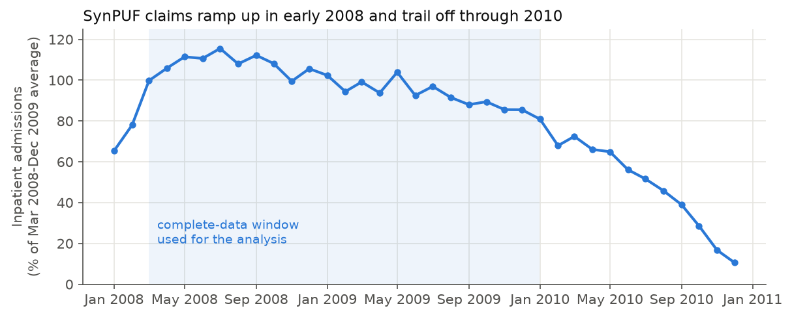
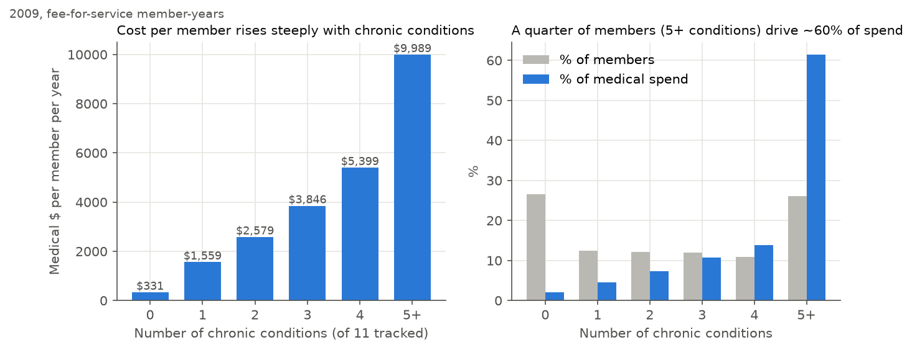
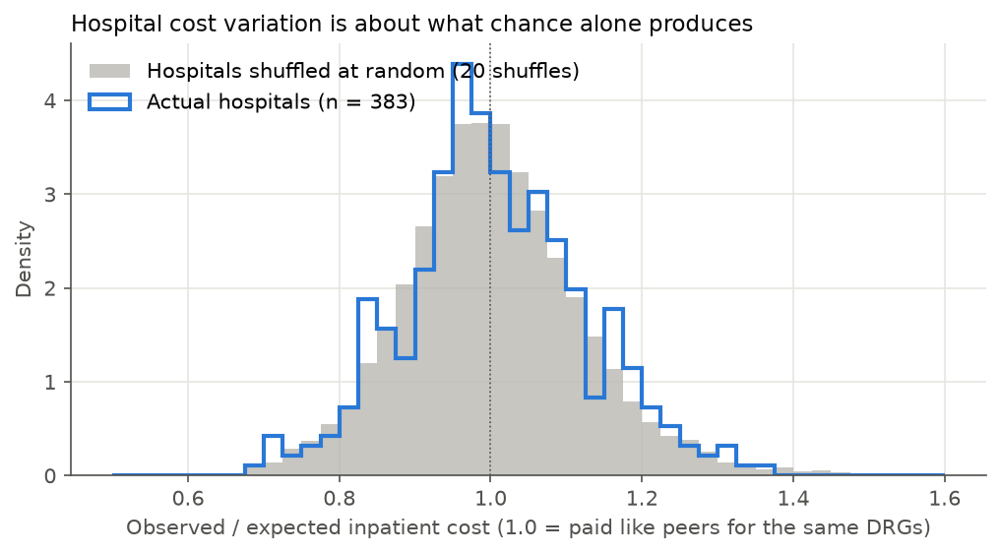

# Medicare claims analytics in SQL: DuckDB on CMS DE-SynPUF

Three questions every health-plan cost team answers, written as plain SQL on
about 11 million synthetic Medicare claims and run in DuckDB on a laptop:

1. **What do we spend per member per year (PMPY), and where?**
2. **What does an inpatient episode cost once you count the 30 days after
   discharge?**
3. **Which hospitals cost more than their peers for the same kinds of cases, and
   is that difference real?**

The SQL is the deliverable: [`sql/`](sql/) has four commented files, and the
whole pipeline (download, load, query, export) reruns with one command.

> **This is synthetic data.** CMS built DE-SynPUF for training and software
> testing. Each variable was synthesized to look realistic, but relationships
> *across* files and providers were deliberately weakened to protect privacy.
> The numbers below show the method working. They are not findings about
> Medicare.

## Data

[CMS 2008–2010 Data Entrepreneurs' Synthetic Public Use File (DE-SynPUF)](https://www.cms.gov/data-research/statistics-trends-and-reports/medicare-claims-synthetic-public-use-files/cms-2008-2010-data-entrepreneurs-synthetic-public-use-file-de-synpuf),
**sample 2** of 20. (Sample 1's 2010 beneficiary file is a broken link on the CMS
site.)

| Table | Rows | Source file |
|---|---|---|
| `bene` | 343,858 member-years | Beneficiary summary 2008, 2009, 2010 |
| `ip` | 66,434 inpatient claims | Inpatient claims (segments collapsed to one row per claim) |
| `op` | 781,361 outpatient claims | Outpatient claims |
| `carrier` | 4,745,914 physician/supplier claims | Carrier claims A + B (13 wide line columns summed) |
| `rx` | 5,561,154 drug fills | Part D prescription drug events |

**Data check 1: completeness window.** Monthly claim counts ramp up in Jan–Feb 2008
(stays that began in 2007 are missing) and fall steadily through 2010. By
December 2010 inpatient volume is about 10% of normal. All analyses use **Mar
2008 – Dec 2009**, and PMPY headlines use **2009**, the only complete year.



**Data check 2: reconciliation.** Claims-based totals are compared with the
beneficiary file's own annual payment fields
([`outputs/tables/reconciliation.csv`](outputs/tables/reconciliation.csv)).
Inpatient and outpatient agree within about 2% in 2008–2009. Carrier claims add
up to only about 72% of the summary figure, and summing allowed amounts instead
reaches about 94%. This looks like a property of the synthetic files (each was
generated separately), not a loading error. I kept Medicare *paid* amounts for
every claim type so the measure is consistent.

## 1. Cost per member per year: [`sql/01_pmpy.sql`](sql/01_pmpy.sql)

The denominator is **fee-for-service member-months**: months with Part A and
Part B, minus Medicare Advantage (HMO) months, whose claims aren't in this data.

| 2009 | Inpatient | Outpatient | Physician | **Medical total** | Drugs (Part D months) |
|---|---|---|---|---|---|
| PMPY | $2,343 | $848 | $1,067 | **$4,258** | $1,479 |

* **Spend is concentrated.** The costliest 1% of members account for 14% of
  medical spend, the top 5% for 40% and the top 20% for 75%.
* **It follows chronic illness.** Members with 5 or more of the 11 tracked
  chronic conditions are 26% of members and 61% of spend, at about $10,000 PMPY
  against $331 for members with none. This is the arithmetic behind
  care-management programs.



## 2. Episodes: admission + 30 days: [`sql/02_episodes.sql`](sql/02_episodes.sql)

Each **index admission** (no discharge in the prior 30 days) opens an episode
that runs to 30 days after discharge. Readmissions in that window belong to the
episode and don't start a new one. Outpatient and physician claims in the window
are added in. This is the same logic as bundled-payment programs.

| Episodes | Mean cost | Median | 30-day readmission rate | Index stay | Readmissions | Outpatient | Physician |
|---|---|---|---|---|---|---|---|
| 40,651 | $11,014 | $7,960 | 10.6% | 85.7% | 10.6% | 1.7% | 2.0% |

Per-DRG results are in
[`outputs/tables/episodes_by_drg.csv`](outputs/tables/episodes_by_drg.csv).
In real Medicare data the readmission rate is closer to 15–18%, and physician
claims make up a much larger share of an episode. The low cross-file linkage is
one of the synthetic-data limits mentioned above: SynPUF doesn't keep the timing
link between a member's hospital stay and their physician claims.

## 3. Hospital cost vs. peers: [`sql/03_hospital_oe.sql`](sql/03_hospital_oe.sql)

SynPUF has **no provider specialty**, so "peers" are defined by case mix:

* **Expected cost** of an admission = the average payment for its DRG across all
  hospitals.
* **O/E ratio** = a hospital's actual payments ÷ its expected payments.
  O/E = 1.2 means it is paid 20% more than peers would be for the same cases.
* Only DRGs with 20+ admissions and hospitals with 30+ admissions are included
  (383 hospitals, 60% of admissions).

Case-mix adjustment barely reorders hospitals here: raw and O/E rankings
correlate at 0.94. That's expected, because the synthetic DRGs are spread almost
evenly across hospitals.

**Is the spread real? A permutation check.** The 10th–90th percentile O/E range
is 0.85–1.17. To see how much of that chance alone produces, the query reassigns
admissions to hospitals at random (keeping each hospital's size) and recomputes
O/E 20 times:

| | O/E 10th pct | O/E 90th pct | Spread |
|---|---|---|---|
| Actual hospitals | 0.85 | 1.17 | 0.32 |
| Shuffled at random | 0.86 | 1.15 | 0.29 |



**About 90% of the apparent variation between hospitals is noise.** With 30–90
admissions per hospital and payments varying a lot within each DRG, a ranking
like this would put hospitals in a "high-cost" tier by chance. In this synthetic
data that's by design, since provider IDs carry little real signal. **On real
data the same check should come before anyone acts on a provider ranking**,
along with shrinkage toward the mean (empirical Bayes) or confidence intervals.

## Limitations

* Synthetic data: levels, mixes and cross-file relationships are not realistic.
  Treat every number as a demonstration of the query, not a fact.
* Part D cost is total drug cost. SynPUF has no plan-paid amount for drugs.
* Physician payments don't reconcile with the beneficiary summary (see Data check 2).
* O/E uses DRG averages from this one sample. A production version would use a
  national standard and add outlier trimming and shrinkage.

## Rerun

Requires [uv](https://docs.astral.sh/uv/). From the repo root:

```bash
./run_all.sh
```

The first run downloads about 380 MB of zips from CMS. `downloads.cms.gov` is
slow and sometimes stalls, so the script resumes broken downloads. Unzipped,
that's about 3 GB in `data/` (gitignored). Loading into DuckDB and running every
query takes about 25 seconds.

| Step | What it does |
|---|---|
| `src/01_fetch_data.py` | Download and unzip the 8 SynPUF files |
| `src/02_run_sql.py` | Run `sql/00_load.sql` … `03_hospital_oe.sql` against `data/synpuf.duckdb`; export each `out_*` table to `outputs/tables/` |
| `src/03_figures.py` | Draw `outputs/figures/*.png` |

To explore interactively: `uv run python -c "import duckdb; duckdb.connect('data/synpuf.duckdb').sql('FROM out_pmpy_by_year').show()"`.
